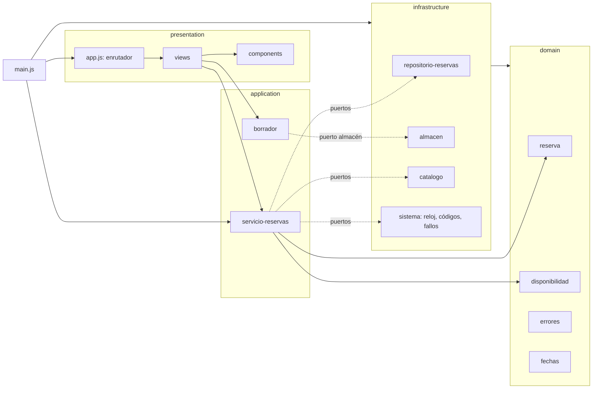
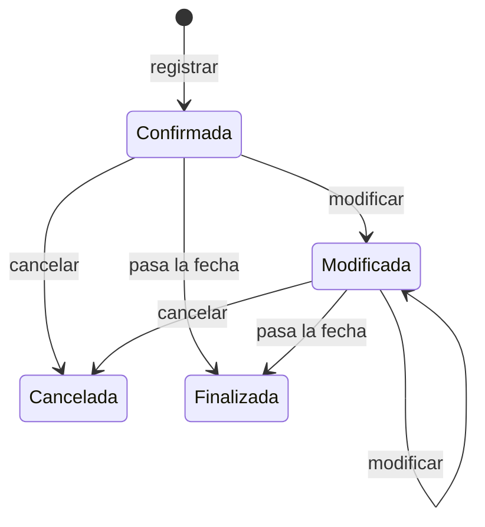

# Arquitectura de software

Aplicación web de una sola página, en JavaScript con módulos ES, sin frameworks ni compilación. Cuatro capas y una raíz de composición.

| Capa | Responsabilidad | No hace |
|---|---|---|
| `domain` | Reglas de la reserva, estados, validaciones, disponibilidad | No usa DOM, almacenamiento ni reloj propio |
| `application` | Casos de uso y borrador; coordina dominio y puertos | No pinta ni conoce `localStorage` |
| `infrastructure` | Adaptadores: almacenamiento, catálogo, reloj, códigos, fallos simulados | No decide reglas de la reserva |
| `presentation` | Vistas, componentes, enrutado, accesibilidad | No guarda directamente ni importa infraestructura |

La presentación lee del dominio solo constantes y utilidades puras (etiquetas de estado y modalidad, límites del motivo, formato de fechas) para no duplicarlas.

## Puertos (inyectados en `main.js`)

| Puerto | Operaciones | Adaptador | Sustituto posible |
|---|---|---|---|
| Repositorio | `listar`, `guardar` | `localStorage` | API REST |
| Catálogo | `asignaturas`, `docentes`, `ocupados` | Datos de demostración | Sistema académico |
| Reloj | `ahora` | Reloj del sistema | Reloj fijo en pruebas |
| Generador | `id`, `codigo` | Local | Servidor |
| Almacén | `leer`, `escribir`, `borrar` | Web Storage | Memoria en pruebas |

Con una API real, `guardar` y las consultas pasarían a ser asíncronas: habría que añadir `await` en los casos de uso y estados de carga en las vistas. La regla de «un horario, una reserva» tendría que verificarla el servidor.

## Modelo y estados

`Reserva { id, codigo, asignaturaId, docenteId, modalidad, fecha, hora, motivo, estado, creadaEn, actualizadaEn, historial[] }`

`Finalizada` no se almacena: se calcula con el reloj.

## Componentes reutilizables

`h` (DOM seguro), `indicadorPasos`, `grupoOpciones`, `resumenReserva`, `insigniaEstado`, `aviso`, `resumenErrores` y `marcarErrores` (v2), `pedirConfirmacion` (v2).

## Decisiones

| Decisión | Razón | Costo |
|---|---|---|
| Sin framework ni dependencias | Ejecutable y evaluable sin instalar paquetes | Repintado manual y gestión explícita del foco |
| Enrutado por hash | El botón Atrás del navegador funciona y no requiere configurar el servidor | URL con `#` |
| Persistencia local detrás de un puerto | Cumple el alcance sin servidor | No hay datos compartidos entre dispositivos |
| Radios nativos con apariencia de botones | Teclado y lector de pantalla sin código extra | CSS más elaborado |
