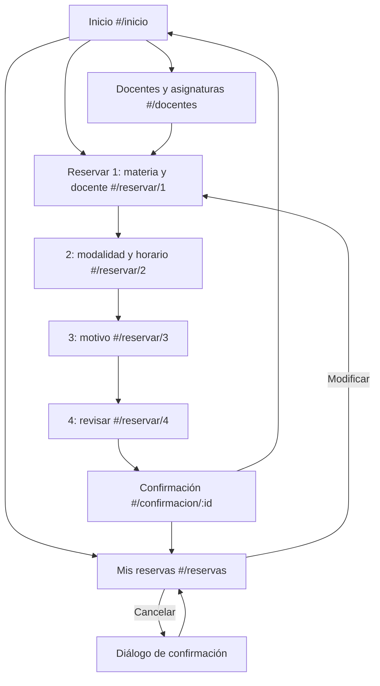

# Sitemap

La navegación principal (Inicio, Docentes, Reservar, Mis reservas) está en todas las pantallas. Si se entra por URL a un paso sin completar los anteriores, la app redirige al primero incompleto.
