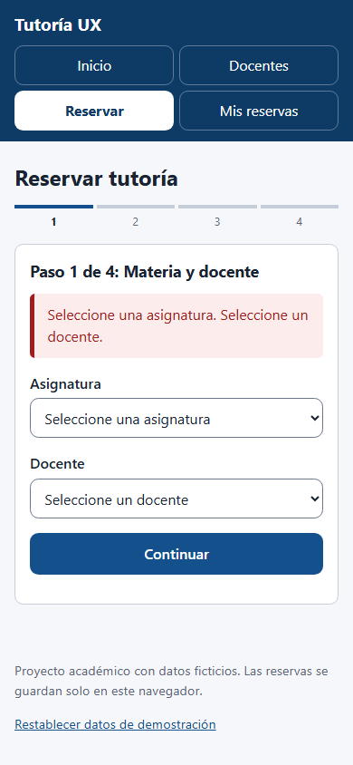
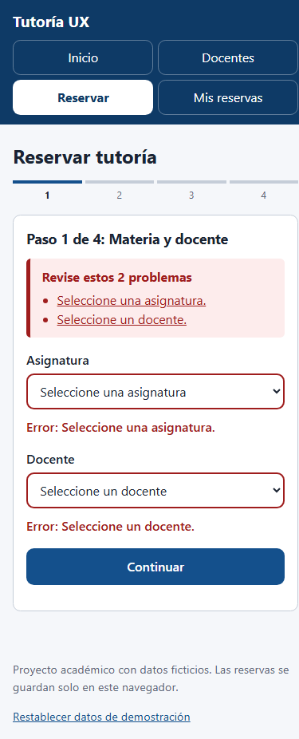
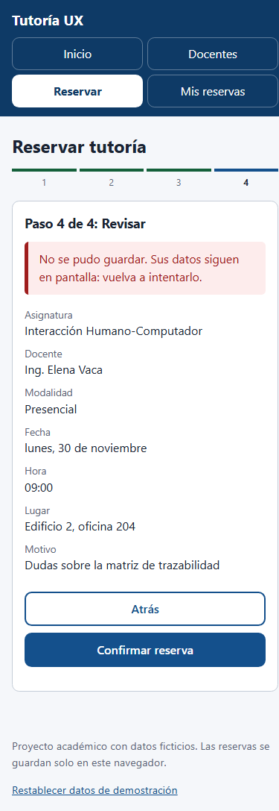
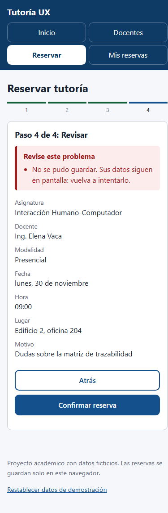
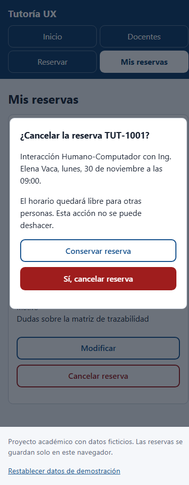

# Reevaluación de la v2

## 1. Reevaluación técnica (hecha el 2026-11-26)

Mismo guion de medición aplicado a v1 y v2, más pruebas automáticas.

| Hallazgo | v1 | v2 | Prueba | Resultado |
|---|---|---|---|---|
| H-01 | Alerta única, 0 campos marcados, foco en `BODY` | Resumen con 2 enlaces, 2 campos marcados, foco en el resumen | 2 pruebas H-01 | Pasa |
| H-04 | «¿Está seguro?» | Diálogo con código, asignatura, docente, fecha y consecuencia; foco en «Conservar reserva»; Escape no cancela | 2 pruebas H-04 | Pasa |
| H-03 | Foco en `BODY`, título fijo | Foco en el encabezado, título por paso | 1 prueba H-03 | Pasa |
| Regresión | 8 pruebas de flujo pasan | 8 pruebas de flujo pasan | `flujo.e2e.mjs` | Sin regresiones detectadas |

| Antes | Después |
|---|---|
|  |  |
|  |  |
| Diálogo nativo «¿Está seguro?» (sin captura automática) |  |

Una prueba automática demuestra que el comportamiento cambió. **No demuestra que las personas usen mejor la aplicación.**

## 2. Reevaluación con usuarios (PENDIENTE)

Repetir en v2 al menos las tareas relacionadas con los hallazgos: provocar un error de validación en T1 y completar T3. Registrar las filas con `version = v2`.

Lo ideal es usar participantes nuevos. Si repiten P01 o P02, anotar que hay **efecto de aprendizaje** y no atribuir mejoras de tiempo a la v2.

| Participante | ¿Es nuevo? | Tarea | H-01: ¿localizó y corrigió el error sin ayuda? | H-04: ¿verificó la reserva antes de cancelar? | Observaciones |
|---|---|---|---|---|---|
| | | | | | |

Para capturar un error de validación sin alterar el enunciado: observar si la persona intenta continuar con datos incompletos; si no ocurre, pedir al final: «Intente continuar sin escribir el motivo y dígame qué entiende».

## 3. Conclusión

_Pendiente: redactar después de la reevaluación con usuarios, separando lo medido de lo interpretado._
