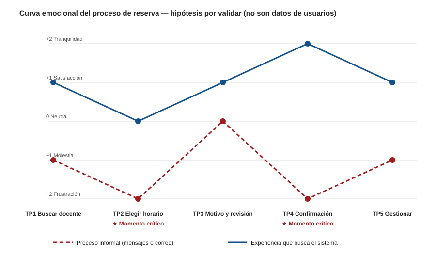

# Análisis de experiencia de usuario

> **Naturaleza de este análisis:** el perfil, las necesidades y la curva son una **proto-persona e hipótesis del equipo**. No proceden de entrevistas. Se contrastan con las sesiones P01 y P02 (ver [Cómo se validan](#cómo-se-validan-las-hipótesis)).

## Perfil de usuario

| Aspecto | Descripción |
|---|---|
| Proto-persona | «Andrea», estudiante de carrera universitaria que necesita apoyo en una asignatura. |
| Dispositivo | Celular entre clases; computador en casa. |
| Contexto | Semana previa a evaluaciones, poco tiempo, interrupciones frecuentes y red inestable. |
| Experiencia digital | Usa aplicaciones a diario; no quiere leer instrucciones. |
| Meta | Asegurar una tutoría en un horario compatible y tener certeza de que quedó registrada. |

## Necesidades

| ID | Necesidad |
|---|---|
| N1 | Saber qué docente atiende cada asignatura. |
| N2 | Ver de una vez qué modalidad, fecha y horario están disponibles y dónde será la tutoría. |
| N3 | Corregir una selección o un error sin volver a escribir. |
| N4 | Tener prueba de que la reserva quedó registrada. |
| N5 | Consultar, cambiar o cancelar la reserva sin pedir ayuda. |

## Cinco touchpoints

| ID | Touchpoint | Acción | Qué piensa | Riesgo | Respuesta del sistema |
|---|---|---|---|---|---|
| TP1 | Consultar docentes y asignaturas | Busca quién puede ayudar | «¿Quién da esta materia?» | No encontrar al docente | Buscador y filtro por asignatura |
| TP2 | Elegir modalidad, fecha y horario | Compara con su agenda | «¿Habrá cupo cuando puedo?» | Horario ocupado o incompatible | Solo días con agenda; ocupados rotulados |
| TP3 | Escribir el motivo y revisar | Describe la duda y comprueba | «¿Está todo bien?» | Enviar datos equivocados o perder lo escrito | Borrador persistente y resumen |
| TP4 | Confirmar | Envía la reserva | «¿Se guardó de verdad?» | Fallo sin explicación, doble envío | «Guardando…», botón bloqueado, código, errores recuperables |
| TP5 | Consultar, modificar o cancelar | Gestiona imprevistos | «¿Puedo cambiarla sin perderla?» | Cancelar la reserva equivocada | Estados visibles, edición con datos cargados, confirmación |

## Momentos críticos (momentos de verdad)

1. **TP2 · Elegir horario.** Aquí se decide si la tutoría es posible. Si la disponibilidad no es clara, o el horario se ocupa a último momento, la persona abandona. Es crítico porque un fallo obliga a replantear la agenda.
2. **TP4 · Confirmación.** Aquí se gana o pierde la confianza. Sin una confirmación inequívoca la persona repite el envío o escribe al docente para verificar; si hay un error y se borran sus datos, no vuelve a intentarlo.

## Curva emocional

Escala: −2 frustración · −1 molestia · 0 neutral · +1 satisfacción · +2 tranquilidad.

| Etapa | Proceso informal | Experiencia buscada | Razón de la hipótesis |
|---|---|---|---|
| TP1 | −1 | +1 | La información de quién atiende está dispersa. |
| TP2 | −2 | 0 | Se negocia el horario por mensajes; en el sistema sigue existiendo la tensión de no hallar cupo. |
| TP3 | 0 | +1 | Explicar la duda es sencillo si no se pierde lo escrito. |
| TP4 | −2 | +2 | Sin respuesta no hay certeza; un código y un estado la dan. |
| TP5 | −1 | +1 | Cambiar por mensajes depende de que alguien conteste. |

## Oportunidades de mejora y justificación

| ID | Oportunidad | Etapa / necesidad | Justificación | Requisito |
|---|---|---|---|---|
| O1 | Búsqueda y filtro de docentes por asignatura | TP1 / N1 | Evita preguntar a terceros | R1 |
| O2 | Mostrar disponibilidad real con lugar o sala | TP2 / N2 | Reduce intentos fallidos en el primer momento crítico | R2 |
| O3 | Guardar el borrador y explicar cada error con su solución | TP3–TP4 / N3 | Un error no debe costar los datos | R2, R3 |
| O4 | Comprobante con código y estado | TP4 / N4 | Da certeza en el segundo momento crítico | R3, R4 |
| O5 | Modificar conservando el código; cancelar con confirmación explícita | TP5 / N5 | Evita duplicados y cancelaciones accidentales | R5, R6 |

## Cómo se validan las hipótesis

En cada sesión se registra el **SEQ** (1–7) al terminar cada tarea y las citas del participante. T1 cubre TP1–TP4; T2 y T3 cubren TP4–TP5. Después de P01 y P02 se anota aquí, sin borrar la hipótesis:

| Hipótesis | ¿Se observó? (sí / no / no concluyente) | Evidencia (participante, tarea, observación) |
|---|---|---|
| TP2 genera duda sobre la disponibilidad | _pendiente_ | _pendiente_ |
| TP4 produce tranquilidad al ver el código | _pendiente_ | _pendiente_ |
| Recuperarse de un fallo no obliga a reescribir | _pendiente_ | _pendiente_ |
