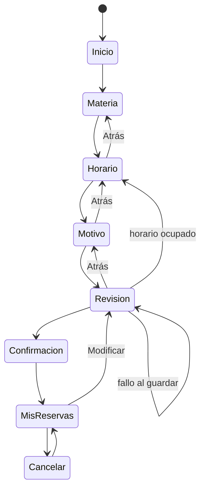

# Prototipo navegable

Abrir [`index.html`](index.html) con doble clic (no requiere instalación). Es de **baja fidelidad visual y alta fidelidad de interacción**. Usa datos genéricos.

## Estados incluidos

| Tipo | Cómo provocarlo |
|---|---|
| Normal | Inicio → Reservar → pasos 1 a 4 |
| Vacío | «Mis reservas» antes de reservar |
| Error de validación | Pulsar «Continuar» sin completar: el prototipo lleva al primer paso incompleto y explica qué falta |
| Error de horario | Marcar «El horario se ocupa al confirmar» y confirmar |
| Error de guardado | Marcar «Falla el guardado» y confirmar |
| Recuperación | Elegir otro horario o confirmar otra vez; el motivo sigue escrito |
| Confirmación | Pantalla con código; después «Cambios guardados» al modificar |
| Modificación | Mis reservas → Modificar → Atrás para cambiar cualquier paso |
| Cancelación | Mis reservas → Cancelar reserva → confirmar o conservar |

## Transiciones

El prototipo funcional de alta fidelidad es la propia aplicación (`npm start`). Para forzar errores en ella: `?fallo=ocupado` o `?fallo=guardar`.
