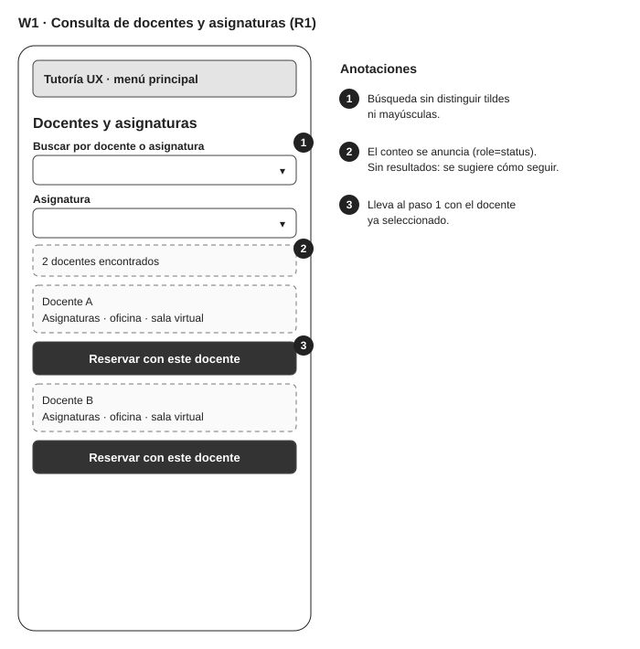
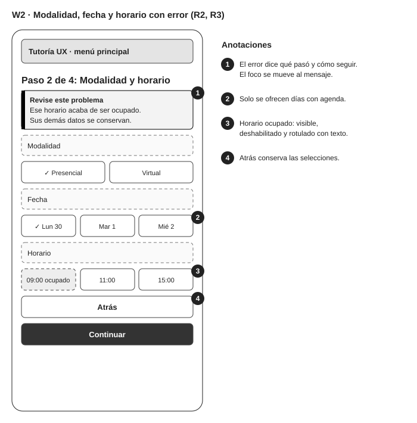
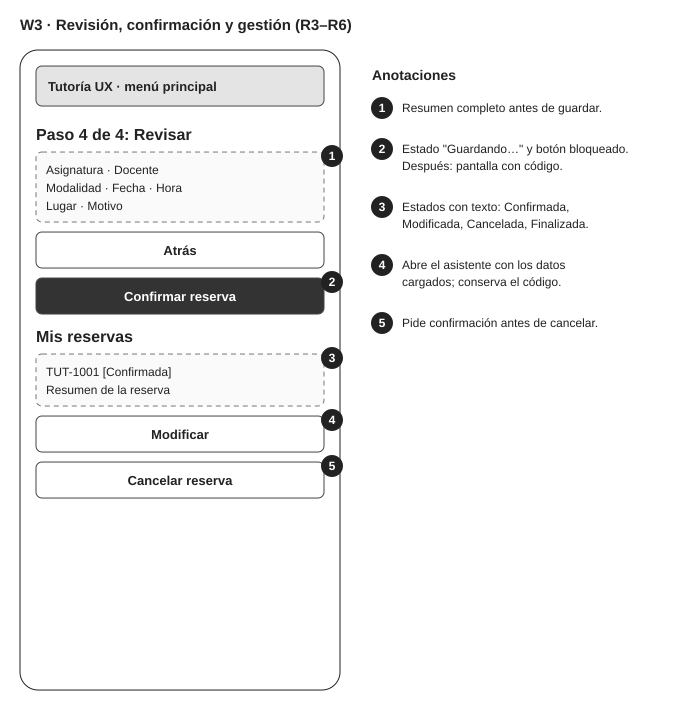

# Wireframes (baja fidelidad)

## W1 · Consulta de docentes y asignaturas

## W2 · Modalidad, fecha y horario, con estado de error

## W3 · Revisión y gestión de reservas

Los wireframes fijan contenido y jerarquía. El aspecto final está en `src/presentation/`.
